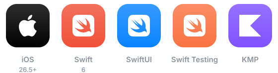
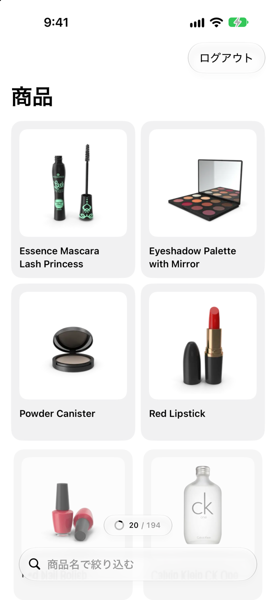
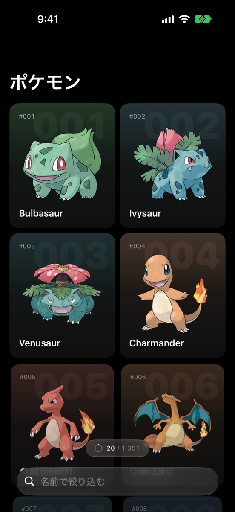
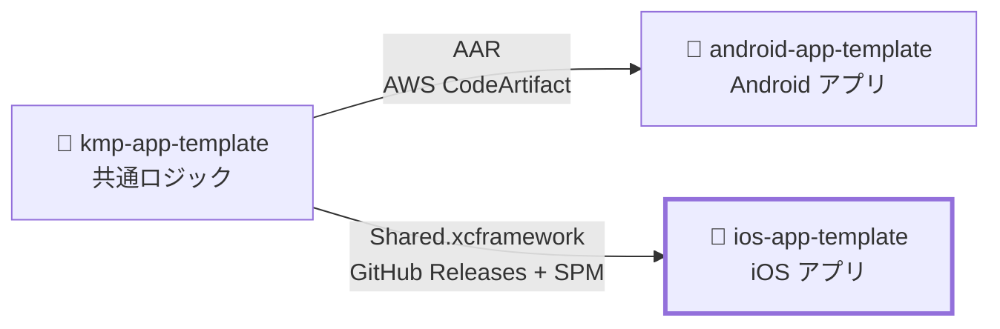
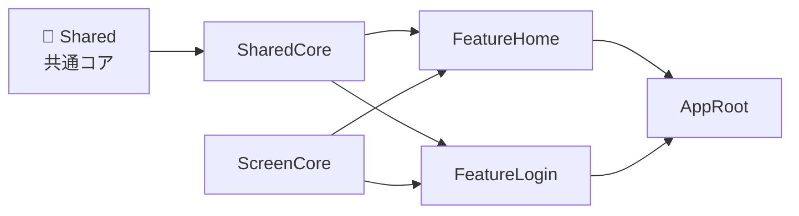

# 🍎 ios-app-template

SwiftUI と Kotlin Multiplatform で作る、商品一覧アプリのテンプレート



## ✨ 機能

| 商品の一覧（ライト） | 商品の一覧（ダーク） |
| --- | --- |
|  |  |

| 機能 | 内容 |
| --- | --- |
| ログイン | DummyJSON にログインする |
| 無限スクロール | 一覧を下へ進むと続きを読み込む |
| 絞り込み | 商品名で絞り込む |

## 🗺️ 全体像



[🧩 kmp-app-template](https://github.com/yossibank/kmp-app-template) ・ [🤖 android-app-template](https://github.com/yossibank/android-app-template)

### モジュール構成



| モジュール | 役割 |
| --- | --- |
| `SharedCore` | 共通コアとの境界。KMP の型を Swift の型に直して渡す |
| `ScreenCore` | 画面の土台（読み込み状態の管理）と、機能に依らない UI 部品 |
| `FeatureHome` | 一覧の画面 |
| `FeatureLogin` | ログインの画面 |
| `AppRoot` | ログイン状態に応じた画面の切り替え |

## 💻 実行環境

| 項目 | 内容 |
| --- | --- |
| 対応 OS | iOS 26.5+ |
| 言語 | Swift 6 |
| 共通コア | Kotlin Multiplatform |
| 整形・lint | SwiftFormat 0.63.1、SwiftLint 0.65.1（Mint） |

[手順とコマンド](docs/development.md)

## 🚀 入れ方

```sh
# テンプレートから作ったとき：GitHub のオーナーとパッケージの接頭辞を置き換える
# 3 つのリポジトリそれぞれで実行する
scripts/rename.sh <GitHub のオーナー> <パッケージの接頭辞>    # 例: scripts/rename.sh acme com.acme

# 共通コアを手元のものに差し替える：kmp-app-template で make build-ios した後、絶対パスで渡す
SHARED_DIR=/path/to/kmp-app-template make verify
```

## 📚 文書

| 文書 | 内容 |
| --- | --- |
| [docs/development.md](docs/development.md) | 動かし方と、共通コアを取得する資格情報 |
