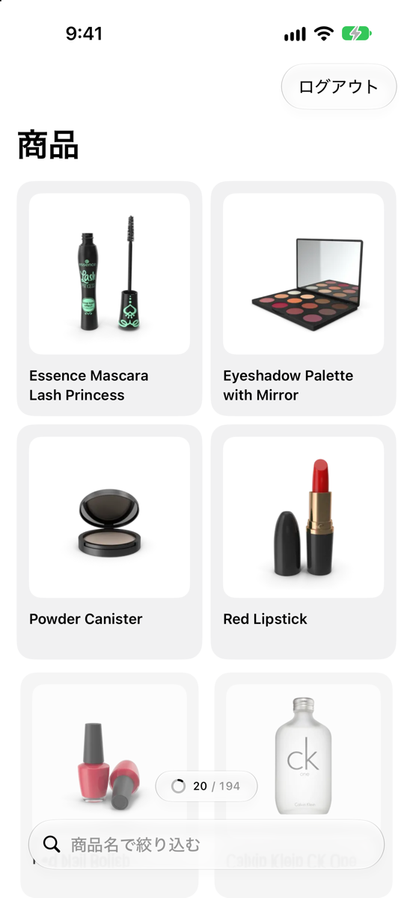
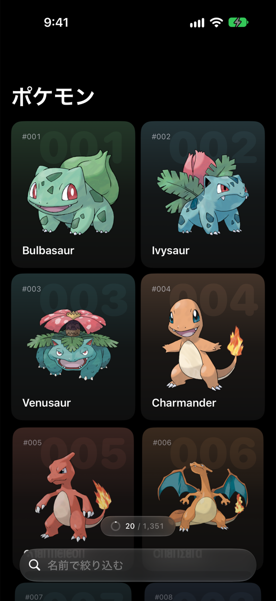
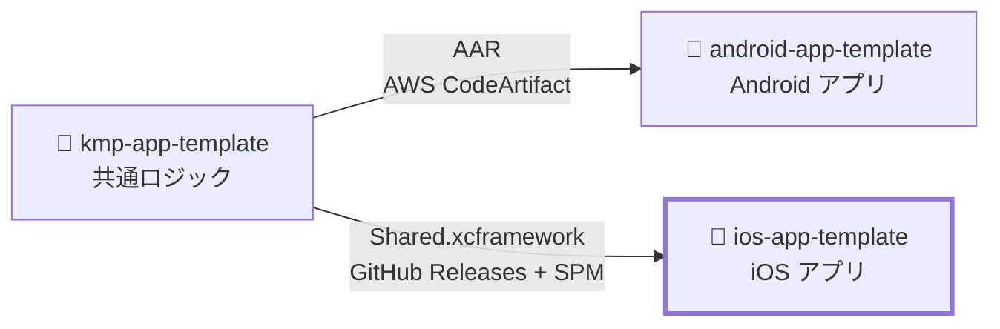
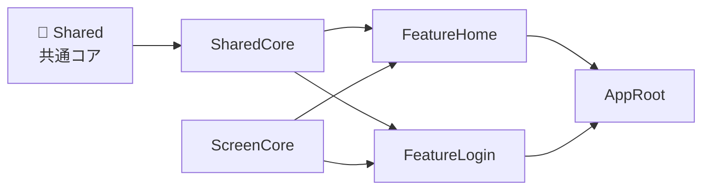

# 🍎 ios-app-template

SwiftUI と Kotlin Multiplatform で作る、商品一覧アプリのテンプレート

[](https://github.com/yossibank/ios-app-template/actions/workflows/verify.yml)
[](LICENSE)

Swift ・ SwiftUI ・ Swift Testing ・ Kotlin Multiplatform




DummyJSON にログイン ・ 無限スクロール ・ 商品名で絞り込み

## 3 つのリポジトリ



[🧩 kmp-app-template](https://github.com/yossibank/kmp-app-template) ・ [🤖 android-app-template](https://github.com/yossibank/android-app-template)

## モジュール構成



| モジュール | 役割 |
| --- | --- |
| `SharedCore` | 共通コアとの境界。KMP の型を Swift の型に直して渡す |
| `ScreenCore` | 画面の土台（読み込み状態の管理）と、機能に依らない UI 部品 |
| `FeatureHome` | 一覧の画面 |
| `FeatureLogin` | ログインの画面 |
| `AppRoot` | ログイン状態に応じた画面の切り替え |

## 動かし方

| 順 | コマンド | 内容 |
| --- | --- | --- |
| 1 | `make bootstrap` | SwiftFormat / SwiftLint と、コミット前に整形と lint を検査するフックを用意する |
| 2 | `make open` | `AppTemplate.xcworkspace` を開く |
| 3 | `make verify` | 変更したら通す |

> [!NOTE]
> kmp-app-template をプライベートにしたときは、`~/.netrc` に `api.github.com` の資格情報が要る（[組み込みの手順](https://github.com/yossibank/kmp-app-template/blob/main/docs/integration.md#ios)）。

### 共通コアを手元のものに差し替える

kmp-app-template で `make build-ios` してから、そのディレクトリを絶対パスで渡す。

```sh
SHARED_DIR=/path/to/kmp-app-template make verify
```

### テンプレートから作ったとき

パッケージの接頭辞と GitHub のオーナーを置き換える。3 つのリポジトリそれぞれで実行する。

```sh
scripts/rename.sh <GitHub のオーナー> <パッケージの接頭辞>    # 例: scripts/rename.sh acme com.acme
```

